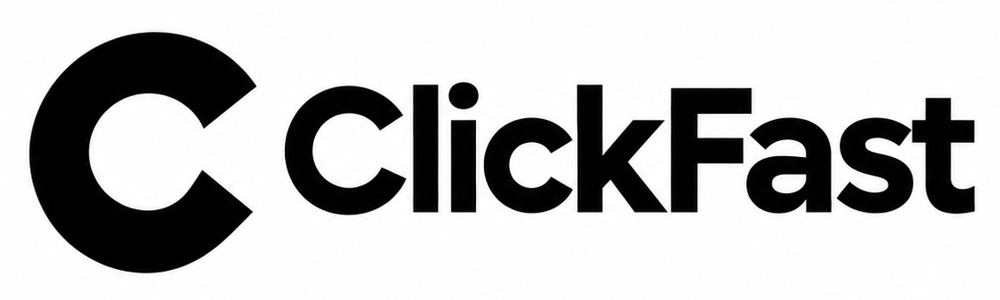

<p align="center">
  
</p>

ClickFast connects your iPhone to Codex and other AI agents. Your agent can open apps, tap buttons, enter text, scroll, and check the screen.

Try a task such as “Open Weather and search for São Paulo.” The agent reads the phone’s controls, chooses the actions, and checks the result.

ClickFast sends actions directly to the phone over USB. Several steps can run in one request, which cuts the wait between taps.

## Setup

You need a Mac, Xcode, Node 22 or newer, and an iPhone with Developer Mode enabled. Xcode needs an Apple development team to sign the runner.

```sh
git clone https://github.com/xylotropic/ClickFast.git
cd ClickFast
brew install libusbmuxd
node scripts/setup.mjs --udid YOUR_PHONE_UDID --team YOUR_TEAM_ID
codex mcp add clickfast -- node "$PWD/src/cli.mjs" mcp
```

Keep the phone unlocked during setup. Once connected, ask Codex to try a small task. Other agents can use the same MCP connection.

You can also let JEV choose the next action from the current screen controls. That option needs a TypeSafe API key. See the [setup and control reference](docs/control-reference.md).

## Results

Ten recorded Calculator and navigation tasks took **7.46 seconds with ClickFast** and **30.53 seconds through iPhone Mirroring**. Both completed all ten using known action plans. The timings include actions and result checks, but exclude setup and app launch. [Watch the comparisons](benchmarks/runs/2026-11-11-operator-vs-mirroring/comparison.md).

JEV completed **7 of 12** tasks in a separate test across more apps. General control still needs work. The [full results](docs/general-control-results.md) include the failed attempts.

ClickFast sets media volume to zero before control. Apple still shows its system “Automation Running” screen during XCTest control.

## Docs

- [Setup, commands, and current limits](docs/control-reference.md)
- [Phone test results](docs/operator-performance.md)
- [Wireless control](docs/wireless.md)
- [JEV setup and notes](docs/jev.md)
- [Logo files](docs/brand/)

MIT. Based on Callstack’s MIT release of iphone-use. [License and credits](THIRD_PARTY_NOTICES.md).
